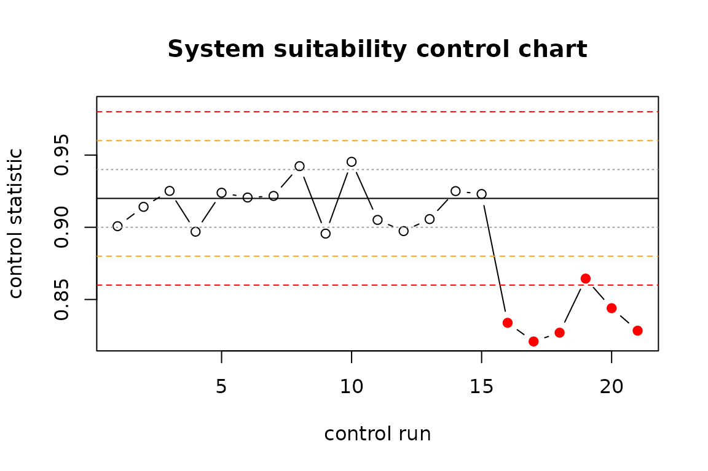

# Validating an LLM pipeline as a measurement system

A pipeline that sends laboratory data, variant descriptions or assay
reports to a large language model and parses a value or a label out of
the answer is a measurement procedure. Before a measurement procedure is
used for decisions, a laboratory asks four questions: how precise is it,
how accurate, how robust against small changes in the way it is
operated, and how is it kept under control once in routine use. `llmsa`
answers these questions for LLM pipelines with the methods laboratories
already trust: variance components (gauge repeatability and
reproducibility), attribute agreement, bias and linearity,
Plackett-Burman robustness screening, simulation-based study planning
and Westgard control charts.

This vignette walks through a complete validation offline, using a mock
backend that behaves like a noisy model. Replace the backend with
[`backend_openai_compatible()`](https://danielmoj.github.io/llmsa/reference/backends.md)
or
[`backend_ellmer()`](https://danielmoj.github.io/llmsa/reference/backends.md)
to validate a real pipeline; nothing else changes.

``` r

library(llmsa)
```

## 1. The study: items x prompts x models x replicates

Items play the role of parts in a gauge study. Here they are variant
descriptions with a reference classification; a real study would draw
them from an expert-curated set (and, for the accuracy question, from
variants the model cannot have memorised).

``` r

set.seed(1)
n <- 24
items <- data.frame(
  item_id = sprintf("VAR%02d", seq_len(n)),
  text = sprintf("NM_%06d.1:c.%dG>A in gene G%d", 1000 + seq_len(n), 100 * seq_len(n), seq_len(n)),
  stringsAsFactors = FALSE)
truth <- setNames(rnorm(n, 0, 1.6), items$item_id)
tiers <- c("Benign", "Likely benign", "VUS", "Likely pathogenic", "Pathogenic")
cuts <- c(-1.5, -0.5, 0.5, 1.5)
items$reference <- tiers[findInterval(truth, cuts) + 1]
```

Prompt variants are the “appraisers”: semantically equivalent ways of
asking. Models are the “instruments”.

``` r

prompts <- c(
  concise  = "Classify the variant {text} using the ACMG/AMP five-tier scheme. Answer with the tier only.",
  role     = "You are a board-certified clinical geneticist. Give the ACMG/AMP classification of {text}.",
  criteria = "List the applicable ACMG/AMP criteria for {text}, then state the resulting tier.")
models <- c("model-a", "model-b")
design <- msa_design(items, prompts, models, reps = 3, blocks = 2, seed = 42)
design
#> Crossed precision study for an LLM pipeline
#>   items (parts):      24
#>   prompt variants:    3  [concise, role, criteria]
#>   models:             2  [model-a, model-b]
#>   replicates/block:   3
#>   blocks (sessions):  2
#>   planned calls:      864
#> 
#> First rows (prompt text truncated):
#>  block position item_id prompt_id model_id rep
#>      1        1   VAR03  criteria  model-a   1
#>      1        2   VAR18  criteria  model-a   3
#>      1        3   VAR09      role  model-a   3
#>      1        4   VAR05   concise  model-a   2
#>      1        5   VAR13      role  model-b   3
#>      1        6   VAR09   concise  model-a   2
#>                                       prompt   model
#>  List the applicable ACMG/AMP criteria fo... model-a
#>  List the applicable ACMG/AMP criteria fo... model-a
#>  You are a board-certified clinical genet... model-a
#>  Classify the variant NM_001005.1:c.500G>... model-a
#>  You are a board-certified clinical genet... model-b
#>  Classify the variant NM_001009.1:c.900G>... model-a
```

Two blocks mean that each replicate set is run twice, ideally on
different days: inference endpoints are not deterministic even at
temperature 0, and the amount of drift is itself a quantity worth
knowing.

## 2. Running it with an audit trail

The mock backend draws a latent score from the item’s truth plus a
prompt effect, a model effect and replicate noise, and writes a sentence
containing the tier, so that the parser is exercised too. `store` keeps
every raw response; an interrupted study resumes from the store.

``` r

backend <- backend_mock(truth, levels = tiers, thresholds = cuts,
                        sd_prompt = 0.25, sd_model = 0.3, sd_rep = 0.45,
                        p_fail = 0.02, seed = 7)
store <- tempfile(fileext = ".csv")
runs <- msa_run(design, backend, parse = parse_choice(tiers), store = store, verbose = FALSE)
runs
#> LLM runs: 864 calls, 24 items, 3 prompt variants, 2 models, 2 block(s)
#>   backend errors: 0   unparseable responses: 16
#>   median latency: 0.00 s
#>  block item_id prompt_id model_id rep             value
#>      1   VAR03  criteria  model-a   1            Benign
#>      1   VAR18  criteria  model-a   3               VUS
#>      1   VAR09      role  model-a   3 Likely pathogenic
#>      1   VAR05   concise  model-a   2     Likely benign
#>      1   VAR13      role  model-b   3     Likely benign
#>      1   VAR09   concise  model-a   2 Likely pathogenic
msa_counts(runs)
#>   prompt_id model_id   n n_valid
#> 1   concise  model-a 144     140
#> 2  criteria  model-a 144     141
#> 3      role  model-a 144     142
#> 4   concise  model-b 144     140
#> 5  criteria  model-b 144     143
#> 6      role  model-b 144     142
```

A response that cannot be parsed is a failed measurement and is counted
as such; it does not silently disappear.

## 3. Precision: variance components and gauge R&R

For an ordinal outcome the model is a cumulative link mixed model; the
variance components live on the latent (probit) scale.

``` r

fit <- msa_fit(runs, type = "ordinal", levels = tiers)
fit
#> Variance components of an LLM measurement system (ordinal outcome, probit link, latent scale)
#>   formula: y ~ 1 + model + block + (1 | item) + (1 | prompt)
#>   24 items x 3 prompts x 2 models x 2 block(s); 848 observations; 2-3 valid replicates per cell
#>    source variance     sd    pct
#>      item  10.8200 3.2894 86.2 %
#>    prompt   0.3957 0.6290  3.2 %
#>     model   0.3351 0.5789  2.7 %
#>     block   0.0002 0.0148  0.0 %
#>  Residual   1.0000 1.0000  8.0 %
#> note: model, block have only two levels and entered as fixed effect(s); the component is derived from the
#>       estimated difference by the range method (beta^2 / 2), as in the AIAG X-bar/R procedure.
grr <- msa_grr(fit)
grr
#> Gauge R&R of an LLM measurement system
#>   outcome: ordinal (latent scale); 24 items x 3 prompts x 2 models x 2 block(s), 848 observations
#>  Source               Variance SD     % Contribution % Study Var
#>  Total gauge R&R      1.7310   1.3157 13.8 %         37.1 %     
#>    Repeatability      1.0000   1.0000 8.0 %          28.2 %     
#>    Reproducibility    0.7310   0.8550 5.8 %          24.1 %     
#>      prompt           0.3957   0.6290 3.2 %          17.8 %     
#>      model            0.3351   0.5789 2.7 %          16.3 %     
#>      block (time)     0.0002   0.0148 0.0 %          0.4 %      
#>  Part-to-part (items) 10.8200  3.2894 86.2 %         92.8 %     
#>  Total variation      12.5510  3.5427 100.0 %        100.0 %    
#> 
#>   total gauge R&R: 37.1 % of study variation (13.8 % contribution)
#>   number of distinct categories (ndc): 3
#>   ICC (items): 0.862
#>   verdict: UNACCEPTABLE  [basis: % study variation, thresholds 10 / 30]
```

The table reads like any gauge R&R report: how much of the variation the
pipeline sees between items is its own noise (total gauge R&R), split
into replicate noise (repeatability) and the effect of asking
differently or using another model (reproducibility). The number of
distinct categories says how many groups of items the pipeline can tell
apart reliably.

## 4. Agreement and accuracy

[`msa_agreement()`](https://danielmoj.github.io/llmsa/reference/msa_agreement.md)
is the categorical view of the same study: percent consistent cells and
items, Krippendorff’s alpha at several scopes, and, against the
reference, accuracy and Cohen’s kappa.

``` r

ag <- msa_agreement(runs, levels = tiers, reference = "reference", weights = "linear")
ag
#> Attribute agreement of an LLM measurement system
#>   24 items, 864 responses (16 missing/unparseable); categories: Benign < Likely benign < VUS < Likely pathogenic < Pathogenic; weights: linear
#> 
#> Repeatability: 20.8 % of item-prompt-model cells have identical replicates
#>  prompt_id model_id pct_items_consistent
#>    concise  model-a               29.2 %
#>   criteria  model-a               29.2 %
#>       role  model-a               29.2 %
#>    concise  model-b                8.3 %
#>   criteria  model-b                8.3 %
#>       role  model-b               20.8 %
#> 
#> Reproducibility: items consistent across prompts 12.5 %, across models 11.1 %, overall 8.3 %
#> 
#> Krippendorff's alpha:
#>                               scope alpha
#>  replicates (within prompt & model) 0.850
#>       across prompts (within model) 0.825
#>       across models (within prompt) 0.833
#>                      all conditions 0.807
#> 
#> Accuracy vs reference: 63.4 % of responses correct; 8.3 % of items correct in every call
#>  prompt_id model_id pct_correct
#>    concise  model-a      76.4 %
#>   criteria  model-a      62.4 %
#>       role  model-a      74.6 %
#>    concise  model-b      56.4 %
#>   criteria  model-b      41.3 %
#>       role  model-b      69.7 %
#>   Cohen's kappa (linear): modal response vs reference 0.872; all responses vs reference 0.727
```

A pipeline can score well on the modal answer while a single call is
unreliable. Both numbers belong in the report, because a production
pipeline usually makes one call.

## 5. Uncertainty of the estimates

With two models and three prompts the reproducibility components rest on
very few levels. For numeric and binary outcomes
[`msa_boot()`](https://danielmoj.github.io/llmsa/reference/msa_boot.md)
gives parametric bootstrap intervals; the same difficulty is addressed
at the planning stage below.

``` r

num <- msa_simulate(n_items = 30, n_prompts = 3, n_models = 2, n_reps = 3,
                    vc = list(item = 1, prompt = 0.05, model = 0.05, residual = 0.1), seed = 3)
fit_num <- msa_fit(num, type = "numeric")
#> boundary (singular) fit: see help('isSingular')
msa_boot(fit_num, nsim = 30, seed = 1)
#> Parametric bootstrap, 30 replicates, 95 % percentile intervals
#>                      statistic estimate lower upper
#>              grr_pct_study_var    41.24 35.20 53.54
#>           grr_pct_contribution    17.01 12.40 28.67
#>    repeatability_pct_study_var    36.85 31.49 45.80
#>  reproducibility_pct_study_var    18.51  2.06 35.48
#>                            ndc     3.00  2.00  3.00
#>                      icc_items     0.83  0.71  0.88
```

## 6. Bias and linearity (numeric outcomes)

``` r

num$reference <- num$latent
msa_bias(num, reference = "reference")
#> Bias against reference (30 items, 540 values)
#>   mean bias 0.2396  [95 % CI 0.2105, 0.2688]  sd 0.3444  p = 3.14e-48
#>  prompt_id model_id  n   bias     sd  lower  upper  p_value
#>         P1       M1 90 0.4050 0.3378 0.3343 0.4758 4.87e-19
#>         P2       M1 90 0.3602 0.3343 0.2902 0.4302 1.12e-16
#>         P3       M1 90 0.2925 0.2782 0.2342 0.3507 3.62e-16
#>         P1       M2 90 0.1401 0.3007 0.0771 0.2031 2.79e-05
#>         P2       M2 90 0.1535 0.3422 0.0818 0.2252 5.15e-05
#>         P3       M2 90 0.0866 0.3482 0.0137 0.1595   0.0205
#>   linearity: bias = 0.2368 + -0.0121 * reference (slope p = 0.515)
```

## 7. Robustness screening

Robustness asks whether deliberate small changes to the way the pipeline
is operated change the result. A Plackett-Burman design screens up to
eleven such factors in twelve runs. Each run is itself a (small) study;
the response is a summary statistic such as the percent correct.

``` r

factors <- list(
  number_format = c("plain", "scientific"),
  typos         = c("none", "two per prompt"),
  extra_context = c("none", "unrelated paragraph"),
  system_prompt = c("A", "B"),
  temperature   = c("0", "0.7"),
  order         = c("original", "shuffled"))
rob <- pb_design(factors, seed = 1)
rob
#> Plackett-Burman design: 8 runs, 6 factors (8-run design screens up to 7)
#>  run number_format typos extra_context system_prompt temperature order
#>    1             1     1             1            -1           1    -1
#>    2             1    -1            -1             1           1     1
#>    3            -1    -1            -1            -1          -1    -1
#>    4            -1     1             1             1          -1     1
#>    5             1    -1             1            -1          -1     1
#>    6            -1    -1             1             1           1    -1
#>    7             1     1            -1             1          -1    -1
#>    8            -1     1            -1            -1           1     1
#>  number_format_level    typos_level extra_context_level system_prompt_level
#>           scientific two per prompt unrelated paragraph                   A
#>           scientific           none                none                   B
#>                plain           none                none                   A
#>                plain two per prompt unrelated paragraph                   B
#>           scientific           none unrelated paragraph                   A
#>                plain           none unrelated paragraph                   B
#>           scientific two per prompt                none                   B
#>                plain two per prompt                none                   A
#>  temperature_level order_level
#>                0.7    original
#>                0.7    shuffled
#>                  0    original
#>                  0    shuffled
#>                  0    shuffled
#>                0.7    original
#>                  0    original
#>                0.7    shuffled
```

Here the runs are simulated: typos and temperature hurt, nothing else
does.

``` r

set.seed(2)
pct_correct <- 90 - 7 * (rob$typos > 0) - 4 * (rob$temperature > 0) + rnorm(nrow(rob), 0, 0.8)
res <- msa_robustness(rob, pct_correct)
res
#> Robustness screening: 8 runs, 6 factors; response mean 84.5266 (sd 4.7566)
#>   Lenth PSE 0.4909, ME 2.1123, SME 5.2870 (alpha = 0.05)
#>         factor  effect t_lenth active active_simultaneous
#>          typos -7.6768  -15.64   TRUE                TRUE
#>    temperature -4.3809   -8.92   TRUE               FALSE
#>  extra_context -0.8432   -1.72  FALSE               FALSE
#>          order -0.5594   -1.14  FALSE               FALSE
#>  system_prompt -0.0952   -0.19  FALSE               FALSE
#>  number_format -0.0869   -0.18  FALSE               FALSE
#>   active factors (|effect| > ME): typos, temperature
plot(res)
```


Lenth’s pseudo standard error needs no replicate runs; effects beyond
the margin of error are flagged as active and must be controlled by the
procedure (here: spell-check the input, fix the temperature).

## 8. Planning the size of a study

How many items, prompt variants, models and replicates are needed before
the estimated percent gauge R&R can be trusted?
[`msa_plan()`](https://danielmoj.github.io/llmsa/reference/msa_plan.md)
simulates candidate designs from assumed variance components.

``` r

scenarios <- expand.grid(n_items = c(20, 40), n_prompts = c(3, 6), n_models = 3, n_reps = 3)
msa_plan(scenarios, vc = list(item = 1, prompt = 0.05, model = 0.05, residual = 0.1),
         nsim = 10, seed = 1, verbose = FALSE)
#> Study-size planning by simulation (10 simulations per scenario)
#>   true %GRR (study variation) under the assumed variance components: 40.8 %
#>  n_items n_prompts n_models n_reps n_blocks mean q2.5 median q97.5 rmse
#>       20         3        3      3        1 36.4 28.3   35.9  44.5  6.9
#>       40         3        3      3        1 40.3 35.1   39.4  46.1  3.5
#>       20         6        3      3        1 42.5 32.1   42.0  51.6  6.4
#>       40         6        3      3        1 40.7 29.7   41.7  52.5  7.3
#>  pct_singular pct_misclassified
#>          90.0              10.0
#>          90.0               0.0
#>         100.0               0.0
#>          90.0              10.0
```

(Use a few hundred simulations in practice.) The share of singular fits
and the width of the interval both shrink with the number of prompt
variants, not with the number of items: the levels of the factor whose
variance is being estimated are what count.

## 9. Keeping the pipeline under control

A validation is a snapshot. Providers change models silently and prompts
get edited. A small control set with known answers, run before every
productive batch and charted with Westgard rules, catches drift.

``` r

set.seed(3)
control <- c(rnorm(15, 0.92, 0.02), rnorm(6, 0.84, 0.02))   # drift after a silent model update
cc <- msa_control_chart(control, center = 0.92, sd = 0.02)
cc
#> Control chart: 21 points, center 0.9200, sd 0.0200; 6 rejection(s)
#>   rules fired: 1_3s (5), 2_2s (5), R_4s (1), 4_1s (3) 
#>  index         x         z 1_2s  1_3s  2_2s  R_4s  4_1s  10_x reject
#>     16 0.8338469 -4.307656 TRUE  TRUE FALSE  TRUE FALSE FALSE   TRUE
#>     17 0.8209397 -4.953017 TRUE  TRUE  TRUE FALSE FALSE FALSE   TRUE
#>     18 0.8270351 -4.648243 TRUE  TRUE  TRUE FALSE FALSE FALSE   TRUE
#>     19 0.8644863 -2.775686 TRUE FALSE  TRUE FALSE  TRUE FALSE   TRUE
#>     20 0.8439962 -3.800188 TRUE  TRUE  TRUE FALSE  TRUE FALSE   TRUE
#>     21 0.8284303 -4.578484 TRUE  TRUE  TRUE FALSE  TRUE FALSE   TRUE
plot(cc)
```



## 10. The validation report

[`msa_report()`](https://danielmoj.github.io/llmsa/reference/msa_report.md)
writes everything into one self-contained document with the structure a
reviewer expects, including a traceability section with the data hash
and the package versions.

``` r

msa_report(grr, runs = runs, agreement = ag, robustness = res,
           cou = "Pre-classification of sequence variants for review by a geneticist",
           question = "Does the pipeline reproduce the expert tier reliably enough to triage?",
           risk = "medium",
           acceptance = "%GRR < 30 % of study variation; kappa (modal) >= 0.8; no active robustness factor",
           output_file = "validation_report.html")
```

## Using your own pipeline or results

- Wrap any client as `function(prompt, model, row)` returning the text,
  or use
  [`backend_openai_compatible()`](https://danielmoj.github.io/llmsa/reference/backends.md)
  (OpenAI, Ollama, vLLM, LM Studio) and
  [`backend_ellmer()`](https://danielmoj.github.io/llmsa/reference/backends.md).
- Results produced elsewhere go through
  [`as_msa_runs()`](https://danielmoj.github.io/llmsa/reference/as_msa_runs.md):
  one row per call with item, prompt variant, model, replicate and
  parsed value.

## References

- AIAG (2010). *Measurement Systems Analysis*, 4th ed.
- Burdick, R. K., Borror, C. M., Montgomery, D. C. (2003). A review of
  methods for measurement systems capability analysis. *Journal of
  Quality Technology* 35, 342-354.
- CLSI EP05-A3 (2014). *Evaluation of Precision of Quantitative
  Measurement Procedures*.
- ICH Q2(R2) (2023). *Validation of Analytical Procedures*.
- Krippendorff, K. (2011). *Computing Krippendorff’s Alpha-Reliability*.
- Lenth, R. V. (1989). Quick and easy analysis of unreplicated
  factorials. *Technometrics* 31, 469-473.
- Plackett, R. L., Burman, J. P. (1946). The design of optimum
  multifactorial experiments. *Biometrika* 33, 305-325.
- Westgard, J. O. et al. (1981). A multi-rule Shewhart chart for quality
  control in clinical chemistry. *Clinical Chemistry* 27, 493-501.
- U.S. FDA (2025). *Considerations for the Use of Artificial
  Intelligence to Support Regulatory Decision-Making for Drug and
  Biological Products* (draft guidance).
- He, H. and Thinking Machines Lab (2025). *Defeating Nondeterminism in
  LLM Inference*.
